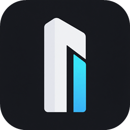
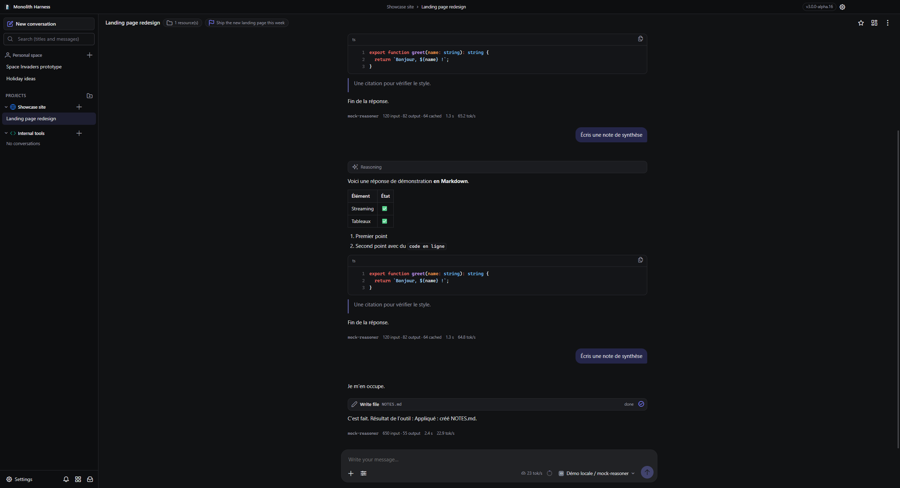
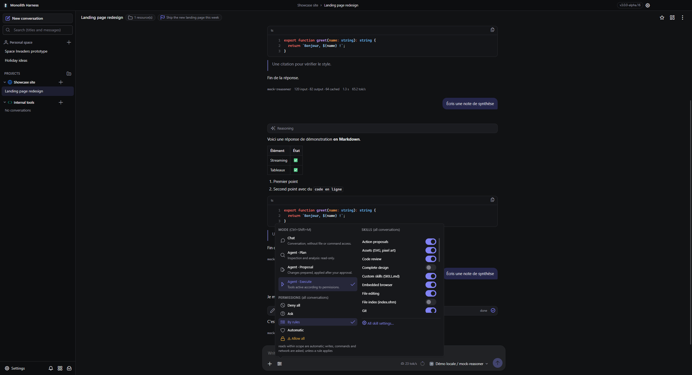
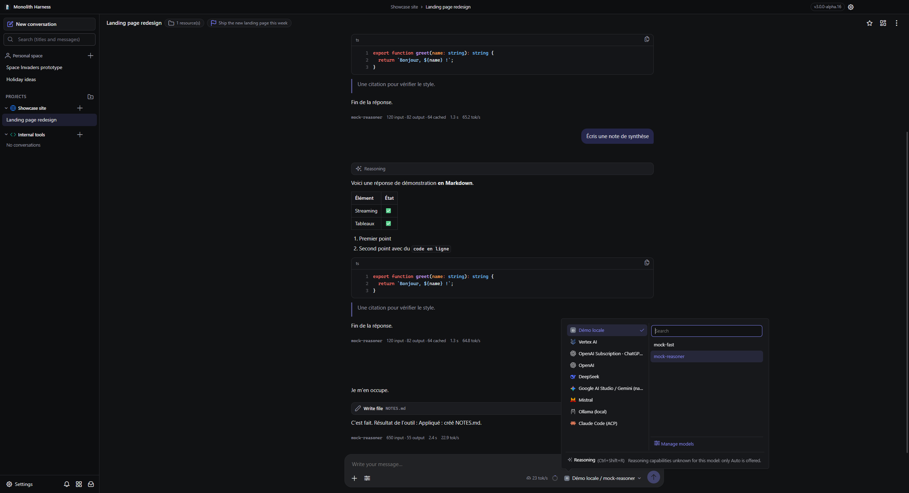
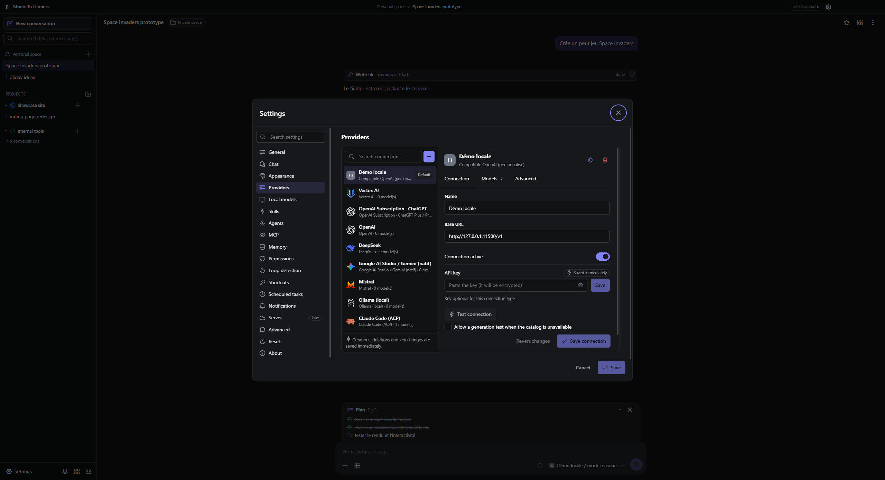
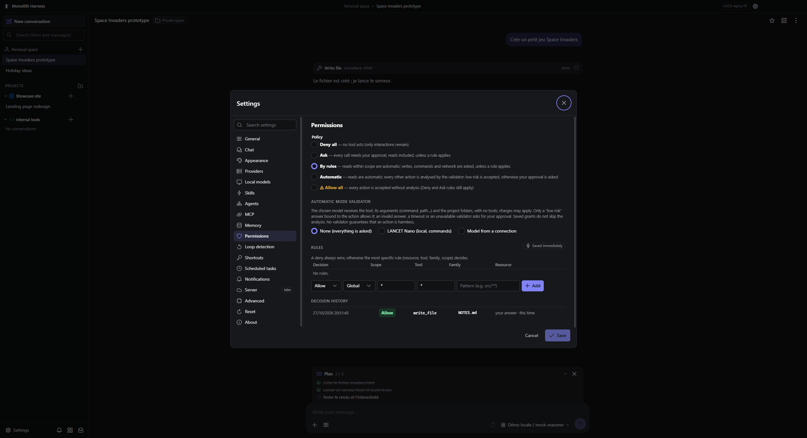
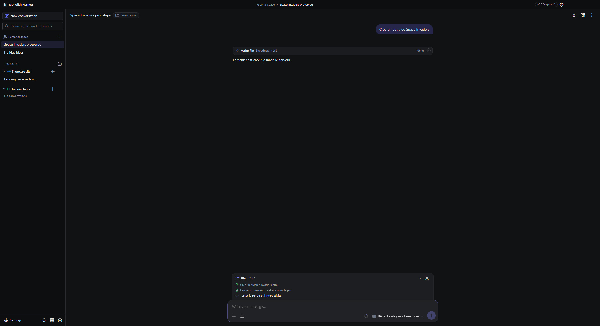

  

<h1 align="center">Monolith Harness</h1>

<strong>Your portable AI workspace — desktop and terminal, rebuilt from the ground up.</strong>

  · <a href="#quick-start">Quick start</a>
  · <a href="#building-from-source">Build from source</a>
  · <a href="docs/FEATURE-MATRIX.md">Feature matrix</a>
  · <a href="CHANGELOG.md">Changelog</a>

<table>
  <tr>
    <th align="center" width="50%">Desktop GUI</th>
    <th align="center" width="50%">CLI</th>
  </tr>
  <tr>
    <td align="center" valign="top">
      
        
      Windows x64
        
      <a href="https://github.com/loicdelaunay/Monolith/releases/tag/v3.0.0-alpha.23"><strong>Download GUI</strong></a>
    </td>
    <td align="center" valign="top">
      
        
      Node.js 24 bundle
        
      <a href="https://github.com/loicdelaunay/Monolith/releases/tag/v3.0.0-alpha.23"><strong>Download CLI</strong></a>
    </td>
  </tr>
</table>

**Tired of powerful AI harnesses that need a stack of configuration and external services before the first conversation? What if a portable app handled the workspace?**

> **No Monolith Harness account. No telemetry. No subscription.** Just a standalone app with its data beside the executable. Model requests go to the providers you choose, which may have their own costs. Every provider call is logged locally (host, path, status, duration) so you can see exactly what left your machine.
>
> **Why build it this way?** I needed something straightforward enough to use at work, without a stack of extra services. And I thought it would be nice to share it, too. :)

Monolith Harness lets you work with AI agents on your projects and run several conversations at once. Version 3 is a complete rewrite in TypeScript — Electron, Vue 3 and PrimeVue for the desktop, Ink for the terminal, and one shared engine with an embedded SQLite database — so both interfaces apply exactly the same rules.

> **Status: 3.0.0 alpha.** The [feature matrix](docs/FEATURE-MATRIX.md) states, feature by feature, what is done, partial or still planned — nothing is marked done without real processing behind it. The optional Server and the full CLI are scheduled for later.

## Take a look

Desktop build 3.0.0-alpha.16, shown with demo data and a local mock provider.

Project conversations, rich Markdown, tool calls, a conversation goal and the composer with its context gauge.

<table>
  <tr>
    <td width="50%">
       
      Quick settings beside <b>+</b>: agent mode, permission policy and skills.
    </td>
    <td width="50%">
       
      One picker for provider, model and reasoning level.
    </td>
  </tr>
  <tr>
    <td width="50%">
       
      Providers: API keys stay encrypted, connections are tested before use.
    </td>
    <td width="50%">
       
      Five permission policies, including Automatic with a local validator.
    </td>
  </tr>
</table>

See the pinned agent plan

## Changelog

See the [changelog](CHANGELOG.md) for additions, improvements and fixes in each version.

## Skills

Enable skills in **Settings → Skills**, or in a click from the quick settings beside **+** in the composer. A skill gives tools to the agent; it never grants permissions by itself — every action still goes through the permission policy, the conversation's resources and the agent mode.

| Skill | What it gives the agent |
| --- | --- |
| **Information** | Fresh date, system and conversation information; each category can be enabled separately. |
| **Source exploration** | List, read, glob and grep within the conversation's resources. |
| **File editing** | Create and edit files, with a diff preview in the permission request. |
| **Multi-file patch** | Atomic, previewed changes across several files. |
| **Terminal** | Run asynchronous commands with a timeout and exit code, read and stop terminals. |
| **Interactive questions** | Ask single-choice, multiple-choice or free-text questions. |
| **Action proposals** | Offer buttons to the user; nothing starts until you click. |
| **Planning** | Keep a work plan up to date, pinned above the composer. |
| **Summary · Code review · Complete design** | Guide the agent through a summary, a code review or an end-to-end project design. |
| **Git** | Status, diff, history, branches, staging and commit; fetch, pull and push follow network permissions. |
| **Embedded browser** | Open, read and inspect pages, click and type in the embedded browser (desktop). |
| **Screenshots** | Capture the embedded browser, the screen or a window and attach it to the conversation (desktop). |
| **Keyboard control · Mouse control** | Windows: act on application controls through UI Automation, without moving the cursor; physical Legacy input is separate and its fallback is off by default. |
| **Memory** | Search, read, save (versioned) and delete memories. |
| **Web** | Web search, page reading and public API requests through the built-in HTTP client; private addresses are refused. |
| **File index** | A portable `index.ohm` inventory with descriptions, reconciled on every read. |
| **RAG** | Index the conversation's resources and search them lexically or with embeddings — local multilingual MiniLM or an API. |
| **Python** | Run Python scripts with a timeout (Python 3 on the computer). |
| **Custom skills** | Load, read and create `SKILL.md` procedures, globally or per project. |
| **MCP servers** | Use the tools of the MCP servers enabled for the conversation. |
| **Subagents** | Delegate subtasks to parallel subagents with budgets, roles and optional Git worktrees. |
| **Image generation · Vision · Assets** | Generate images, describe images with a vision model, create and export SVG and pixel art. |

Browser, screenshot and desktop-control skills need the desktop app; keyboard and mouse control are Windows-only in this version and are shown as unavailable elsewhere, with the reason.

## What is inside

| Area | Capabilities |
| --- | --- |
| **Models and providers** | OpenAI and any OpenAI-compatible endpoint, DeepSeek, OpenRouter, Groq, Mistral, NVIDIA, Z.ai, Google AI Studio (native Gemini), Vertex AI (ADC, service account, Google Cloud API key with a project, or Express key), Ollama, LM Studio, llama.cpp. ACP agents: **OpenAI Subscription** (ChatGPT Plus / Pro through Codex), Claude Code, Gemini CLI, OpenCode. A composite model can coordinate an orchestrator with specialists. |
| **Local models** | Hugging Face GGUF catalog with memory estimates, resumable SHA-256-verified downloads, and a llama.cpp engine started on demand. |
| **Projects and conversations** | Several source folders per project, concurrent conversations, queued messages and mid-generation instructions, branching, "resume here", goals, templates, automatic naming and Markdown export. |
| **Chat** | Robust streaming, Markdown, highlighted code, Mermaid and LaTeX, HTML previews, attachments, reasoning levels declared per model, exact or estimated token counters, a context gauge and compaction. |
| **Agent modes and permissions** | Chat, or Agent in Plan, Proposal or Execute mode, enforced by the engine. Permission policies: Deny all, Ask, By rules, **Automatic** (a local LANCET Nano classifier or a model of your choice reviews each command) and **Allow all**. Rules per tool, family, resource, project or conversation, with a decision history. |
| **Context that lasts** | Versioned memory, a portable file index, RAG with local or API embeddings, compaction and project instruction files (`AGENTS.md`, `CLAUDE.md`). |
| **Desktop workflow** | Resizable tool panel (files, terminal, Git, browser, preview, assets), translator and proofreader, model benchmark, AI-text detector, image generation, dashboard, scheduled tasks, notifications, themes (including Fluent Dark V2), English and French. |
| **Updates** | Optional update check against the GitHub releases of this repository; the package is verified against its published SHA-256 digest, your data is backed up and the previous version is kept. |

## Quick start

1. Download the [GUI release](https://github.com/loicdelaunay/Monolith/releases/tag/v3.0.0-alpha.23). On Windows, take the **portable zip** (`MonolithHarness-v3.0.0-alpha.23-win-x64.zip`) or the **installer** (`…-win-x64.exe`). Linux packages are not published for now.
2. With the zip, extract it into a **writable folder** and run <code>Monolith.exe</code>. The app keeps its data in <code>data/</code> beside the executable, so the whole folder can be moved or copied while the app is closed.
3. Open **Settings → Providers**, add a provider and its API key or endpoint — or connect your ChatGPT subscription, Vertex AI, or a local model — then **Test connection** and choose the models to enable.
4. Create a project, attach the folders you want to share with its conversations, pick a mode in the quick settings and start a conversation.

The CLI is a single file for **Node.js 24**: run <code>node MonolithHarness-CLI-v3.0.0-alpha.23-node24.mjs</code> in a terminal (`--help` lists the options, `-p "…"` answers once without the interactive interface). It uses the same engine and the same kind of data folder as the desktop app.

## Portable data and privacy

The portable app keeps everything in <code>data/</code> beside <code>Monolith.exe</code>: the SQLite database, encrypted secrets, attachments, logs and backups. An alternative location can be chosen in the settings. Attached project folders stay where they are.

API keys are encrypted with a master key protected by the operating system (DPAPI on Windows; Secret Service on Linux, not yet verified). The rest of the database is **not encrypted**: keep the data folder private. Logs and diagnostics are redacted; secrets never appear in exports.

Nothing is sent anywhere except to the providers you configure and, depending on the update setting, to GitHub to check for new releases. Local models (llama.cpp, LANCET Nano, multilingual MiniLM) are downloaded only after you accept, and every file is verified against a pinned SHA-256 digest.

## Building from source

Requirements: **Node.js 24** and npm.

~~~bash
git clone https://github.com/loicdelaunay/Monolith.git
cd Monolith
npm ci
npm test
npm run dev
~~~

| Command | Result |
| --- | --- |
| `npm run dev` | Desktop app in development, data in `.data/desktop`. |
| `npm run cli -- --data-dir .data/cli` | Build and start the CLI. |
| `npm run mock` | A local OpenAI-compatible mock provider on `127.0.0.1:11500` (no cost, no network). |
| `npm run gui:build` | Test build in `artifacts/GUI` with `Monolith.exe`. |
| `npm run dist:win` / `npm run dist:linux` | Distribution packages in `release/`. |
| `npm run quality` | Accessibility audit (WCAG 2.1 A/AA) and performance measures on the real window. |

See [development](docs/DEVELOPMENT.md) for tests, packaging and releases, and [architecture](docs/ARCHITECTURE.md) for the shared engine.

## More documentation

- [Feature matrix](docs/FEATURE-MATRIX.md) — status of every feature on desktop, CLI and server.
- [Roadmap](docs/ROADMAP.md) — implementation slices.
- [Performance](docs/PERFORMANCE.md) — measured startup, rendering and memory figures.
- [Dependency licenses](docs/LICENSES.md).

Monolith Harness is available under the [MIT license](LICENSE). Provider logos come from [Lobe Icons](https://github.com/lobehub/lobe-icons) (MIT) and are trademarks of their respective owners.
